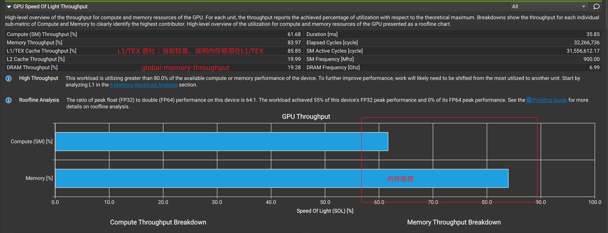
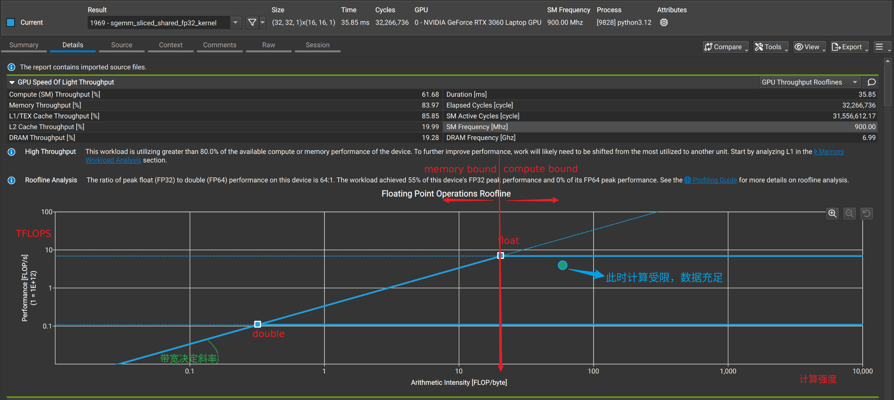

# 2.  GPU speed of Light Throughput 

在 Details 页面中，SOL 区域的作用是**在Summary 中看到的粗略百分比，进行“庖丁解牛”般的拆解**。它不再只告诉你“你被内存卡住了”，而是告诉你“你被哪一级的内存卡住了”。
以下是阅读 SOL 区域信息的“黄金法则”和核心看点：
### 核心概念重温：什么是“光速” (Speed of Light)?

在物理学中，光速是速度的极限。在 ncu 中，**SOL 就是你这块显卡物理硬件的极限吞吐量**。所有的百分比，都是实际运行速度与这个物理极限的对比。

---
### 第一步：看两根主柱子 (High-Level Metrics)

在 SOL 区域的最上方，通常会有两个最核心的大字报或者柱状图：
- **SM [%] (Compute Throughput):** 计算单元（流处理器）的吞吐量占比。
- **Memory [%] (Memory Throughput):** 整个存储子系统的吞吐量占比。
**怎么看：** 谁的数值大，谁就是当前的“老大难”（主要瓶颈）。
- 如果两者都超过了 **60% - 80%**，说明你的代码写得已经很不错了，压榨了大量硬件性能。
- 如果两者都在 **20%** 左右，说明指令延迟很高（Latency Bound），硬件都在“等”，没干活（回想一下我们之前聊的 Occupancy）。

---

### 第二步：向下钻取！看 Memory 的细分 (Memory Throughput Breakdown)

如果你的 **Memory [%]** 很高（比如达到了 80%），说明你是内存受限。这时候，千万不要停留在表面，立刻看下方对 Memory 的细分指标：

ncu 会把 Memory 拆成三个主要层级来看吞吐量：

1. **DRAM Throughput [%]:** 显存（全局内存）。这是最慢的存储。
    - _诊断：_ 如果 DRAM 百分比很高，说明你在疯狂读写显存。
    - _药方：_ 需要检查访存是否合并（Coalesced），或者尝试把频繁复用的数据搬到 Shared Memory 中。
2. **L2 Cache Throughput [%]:** 二级缓存。
    - _诊断：_ 如果 L2 很高，DRAM 很低，说明你的数据命中了 L2 缓存，但 L2 的带宽被榨干了。这通常比 DRAM 受限好，但仍有优化空间。
3. **L1/TEX Cache Throughput [%]:** 一级缓存/纹理缓存。
    - _诊断：_ L1 是最快的缓存。如果这里极高，可能是因为局部变量溢出（Local Memory Spills）或者你有很多未合并的访存导致 L1 缓存行被反复重复读取。
**总结口诀：** 谁的百分比最接近整体的 Memory [%]，谁就是真正的绊脚石。

---

### 第三步：向下钻取！看 Compute 的细分 (SM Throughput Breakdown)

如果你的 **SM [%]** 很高（计算受限），你需要看计算单元在忙什么：

在较新的 ncu 版本中，它会细分 SM 内部的各种管道 (Pipelines)：

- **FMA/FP32/FP64:** 浮点乘加运算。如果这里很高，恭喜你，你的 GPU 正在做它最擅长的事情——算术。
- **ALU (Integer):** 整数运算。如果这里很高，通常说明你在做大量的地址计算、循环计数或者位操作。
- **LSU (Load/Store Unit):** 加载/存储单元。如果 LSU 很高，说明 SM 内部的存取指令下发通道被塞满了，即使外面的内存带宽还没吃满。

---

### 第四步：寻找“屋顶线模型” (Roofline Chart) —— 高阶杀手锏

在 SOL 区域的下方，通常会有一个非常著名的二维图表：**Roofline Model**。 这是评估 kernel 性能最直观的图：

- **横轴 (X轴):** 算术强度 (Arithmetic Intensity)。公式是：Arithmetic Intensity=BytesFLOPs​。意思是，你每从内存读写 1 个字节的数据，能做多少次浮点运算。
- **纵轴 (Y轴):** 性能 (Performance，通常是 TFLOP/s)。
- **两条“屋顶线”:**
    - 斜向上的线：**内存带宽的物理极限**。
    - 水平的线：**计算能力的物理极限**。

**怎么看 Roofline 图：** 图上会有一个**小圆点**，代表你当前 kernel 的状态。

- 如果圆点**撞到了斜线**：你是严格的**内存受限 (Memory Bound)**。你需要向右移动（减少内存读取，增加复用，提高算术强度）。
- 如果圆点**撞到了水平线**：你是严格的**计算受限 (Compute Bound)**。你需要向上突破（使用更快的指令、Tensor Cores 或者减少指令数）。
- 如果圆点**离两条线都很远（在半空中）**：你是**延迟受限 (Latency Bound)**，说明有其他资源（比如寄存器、Occupancy、同步）拖了后腿。
根据你提供的数据，我们可以得出非常明确的结论：**你的 Kernel 是内存受限 (Memory Bound)，并且被死死卡在了 L1 缓存上。**

下面是具体的推理过程和下一步的优化方向：
### 1. 第一层诊断：总体瓶颈 (SM vs Memory)

- **Compute (SM) [%] = 61.68%**
- **Memory [%] = 83.97%**

**结论：** 内存吞吐量远高于计算吞吐量，且逼近了 85% 的高位。这意味着你的计算单元（SM）还有余力，但它们正在排队等待内存子系统完成数据存取。**优化方向坚定地指向访存。**

### 2. 第二层诊断：深挖内存层级 (L1 vs L2 vs DRAM)

这是你这组数据中最有趣的地方：

- **L1/TEX Cache: 85.85% (极高，接近瓶颈)**
- **L2 Cache: 19.99% (很低)**
- **DRAM (显存): 19.28% (很低)**

**结论与现象剖析：** 很多新手一听到“内存受限”，第一反应就是去优化全局内存（DRAM）的读取。但你的数据表明，**你根本没有被显存带宽卡住**（DRAM 只有不到 20%）。

相反，你正在疯狂地轰炸你的 **L1 缓存**。
DRAM 吞吐量低而 L1 吞吐量高，其实包含了一个好消息和一个坏消息：

- **好消息：** 你的缓存命中率（Cache Hit Rate）可能非常高。你需要的数据基本都在 L1 缓存里，不需要跑去遥远且缓慢的 DRAM 里去拿，这省去了大量的延迟。
- **坏消息：** 你的 L1 缓存带宽被榨干了。你的线程由于某种原因，正在产生海量的 L1 缓存请求，导致 L1 的处理通道大塞车。

---

### 3. 寻找“真凶”：为什么 L1 吞吐量会这么高？

在 CUDA 中，导致 L1/TEX Cache 吞吐量爆表通常只有以下三个“罪魁祸首”。你现在需要带着这三个嫌疑犯去排查代码：

#### 嫌疑犯 A：严重的“未合并访存” (Uncoalesced Global Memory Access)

- **原理：** 当一个 Warp（32个线程）去读取全局内存时，如果它们访问的地址是连续的，硬件只需向 L1 缓存发出 1 到 2 次大块请求（Sector Requests）。但如果你的 32 个线程乱序、跳跃地访问内存，这 1 个指令会被拆分成多达 32 次独立的 L1 缓存请求。这会瞬间塞满 L1 的处理队列。
- **排查方法：** 回到 Summary 页面看有没有警告，或者在 Details 页面的 **Memory Workload Analysis** 区域，查看 `Global Load` 对应的 `Sectors/Req`（每个请求对应的扇区数）。如果这个值远大于 4，说明访存合并做得很差。

#### 嫌疑犯 B：Shared Memory bank 冲突 (Bank Conflicts)

- **原理：** Shared Memory 在物理上也是和 L1 放在一起的。如果你的代码大量使用了 Shared Memory，当同一个 Warp 内的多个线程试图同时访问同一个 Shared Memory Bank 的不同地址时，硬件无法并行处理，只能把请求串行化（排队处理）。这种排队会极大拉高 L1/Shared Memory 的吞吐量占用，因为它花了很多周期在处理冲突。
- **排查方法：** 在 Details 页面的 **Memory Workload Analysis** 区域，寻找 `Shared Memory` 的相关指标，特别是查看是否有 `Bank Conflicts` 的警告。 

#### 嫌疑犯 C：寄存器溢出 (Register Spilling / Local Memory Thrashing)

- **原理：** 之前讲 Occupancy 时提到过，每个线程的寄存器是有限的。如果你的 kernel 变量太多，编译器会把放不下的变量丢到“本地内存” (Local Memory) 里。Local Memory 在物理上存在于 DRAM 中，但会被 L1 强力缓存。如果发生严重的寄存器溢出，你的线程就会疯狂地读写 L1 缓存来存取这些本该在寄存器里的变量。
- **排查方法：** 看 Details 页面的 **Memory Workload Analysis**，找 `Local Memory` 的吞吐量。如果有数据，说明发生了 Spill。

这个模块的作用是：**追踪每一个字节的数据，搞清楚它们是从哪个逻辑空间（Global, Shared, Local）发出的，经历了哪些物理硬件（L1, L2, DRAM），并在哪里发生了拥堵。**

由于我们之前已经定位到你的 L1 缓存吞吐量极高（85.85%），我们需要在这个模块里重点寻找三大“罪魁祸首”的直接证据。以下是你需要逐一排查的核心指标：
