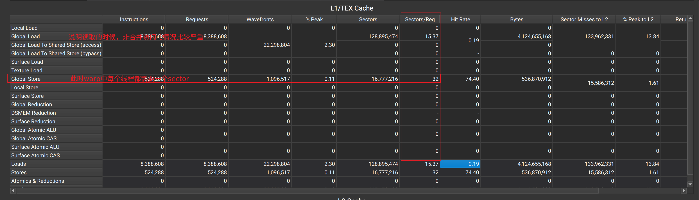
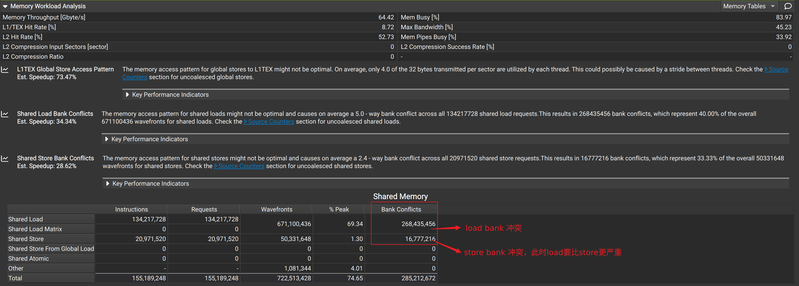

## 1.  Memory Workload Analysis

### 第一步：排查“未合并的全局访存” (Global Memory & Sectors/Req)

在 Memory Workload Analysis 表格中，找到标有 **Global**（全局内存）的那一行或那一块区域。这是最容易出问题的地方。

**重点看这个指标：`Sectors/Req` (Sectors per Request / 每个请求的扇区数)**

- **这是什么：** 当一个 Warp（32个线程）发起一次全局内存访问时，硬件会把它打包成一个 Request。一个 Sector 是 L1 缓存和 DRAM 交互的最小单位（通常是 32 Bytes）。
- **怎么判断：**
    - **完美情况：** 如果 32 个线程连续读取 32 个 `float` (4 Bytes)，总共 128 Bytes，刚好是 **4 个 Sectors**。这时候 `Sectors/Req` 应该等于或接近 4。
    - **糟糕情况：** 如果 32 个线程乱序跳跃访问，每个线程都要一个独立的 32 Bytes 扇区，那么 1 个 Request 会产生高达 **32 个 Sectors**。
- **你的行动：** 去看 Global 这一行的 `Sectors/Req` （通常分 Load 和 Store）。如果这个数值远大于 4（比如达到了 10、20 甚至接近 32），**破案了**：你的代码存在严重的未合并访存，导致海量的无效数据请求塞满了 L1 缓存。

### 第二步：排查“Shared Memory 银行冲突” (Shared Memory Bank Conflicts)

如果你的 Kernel 代码里使用了 `__shared__` 关键字，请务必看这一步。在表格中找到标有 **Shared** 的区域。

**重点看这个指标：`Bank Conflicts` 或 `Conflict Ratio`**

- **这是什么：** Shared Memory 被分成了 32 个 Bank。如果同一个 Warp 里的不同线程，同时访问了同一个 Bank 的不同地址，就会发生 Bank Conflict，硬件只能让这些线程排队（串行）读取。
    
- **怎么判断：**
    
    - **完美情况：** Bank Conflicts 应该为 0。
    - **糟糕情况：** 如果这里出现了数值，或者 NCU 弹出了黄色的警告（比如 "N-way bank conflict"），说明你的线程在抢占共享内存通道。这种排队会极大消耗 L1/Shared Memory 的处理带宽。
- **你的行动：** 检查 Shared 表格，看是否有冲突警告。如果有，你需要修改共享内存的索引方式，或者对共享内存数组进行填充 (Padding)。
    

### 第三步：排查“寄存器溢出” (Local Memory Spilling)

在表格中找到标有 **Local**（本地内存）的区域。

**重点看这个指标：`Load/Store Throughput` 或 `Bytes`**

- **这是什么：** Local Memory 听起来像是在芯片内部，但**在物理上它其实存在于遥远的 DRAM 中**！当你的线程使用的局部变量太多，寄存器装不下时，编译器就会把这些变量“溢出” (Spill) 到 Local Memory 里。由于这部分数据会被 L1 强力缓存，所以会看到极高的 L1 吞吐量。
- **怎么判断：**
    - **完美情况：** 这一行的所有数值（流量）都应该为 0。
    - **糟糕情况：** 如果 Local 这一行有大量的 Bytes 或很高的吞吐量占用。
- **你的行动：** 如果 Local 这一行有数据，说明你的寄存器溢出了。你需要简化 kernel 内部的逻辑，减少中间变量，或者减小每个线程中的大数组。

---
### 第四步：看缓存命中率 (Cache Hit Rates)

最后，你可以看一眼右侧或者下方的缓存命中率：
- **L1 Hit Rate:** 你的 L1 吞吐量那么高，如果命中率也很高（比如 > 80%），说明数据确实在 L1 里，只是被反复且低效地读取（比如刚才说的未合并访存）。如果命中率很低，说明 L1 频繁发生 Cache Miss，数据在不断被替换（Thrashing）。

### 分析当前的瓶颈

代码并没有被显存（DRAM）带宽卡住，也没有寄存器溢出。你的 L1 缓存吞吐量高达 85%，**纯粹是因为你的线程在以极其低效的方式疯狂轰炸 L1 缓存（未合并访存 + Bank 冲突），导致 L1 被无效请求塞满，并且发生了严重的缓存颠簸（Thrashing，导致命中率只有 19%）。**

针对你查出的这些症状，以及“接下来还需要了解什么”，这里是你的终极行动指南：

### 1. 解决最大的毒瘤：Global Store (32 Sectors/Req)

- **病理分析：** 32 是最极端的坏情况！这意味着你的一个 Warp 里 32 个线程，在执行一次写操作时，**每个线程都写到了完全不同的缓存行（Sector）里**。硬件不得不把这一条写指令，拆分成 32 次独立的写请求发给内存系统。
- **常见原因：**
    - **按列写矩阵 (Transposed Access)：** 比如 `C[row * width + col]`，如果你的线程索引（`threadIdx.x`）映射的是 `row` 而不是 `col`，就会发生这种严重的跳跃访问。
    - **结构体数组 (AoS - Array of Structures)：** 如果你有一个很大的结构体数组，每个线程去写结构体里的某个字段，这会导致步长（Stride）极大。
- **药方：** 检查你的索引计算逻辑。务必确保最内层的线程（`threadIdx.x`）访问的是最内层的连续内存地址（内存条上相邻的地址）。必要时，可以考虑将数据结构从 AoS 改为 SoA (Structure of Arrays)。
    
### 2. 解决 Shared Memory 银行冲突 (Load 严重)

- **病理分析：** 你的线程在从 Shared Memory 读数据时，多个线程凑巧访问了同一个 Bank 的不同地址，导致通道拥堵排队。
- **常见原因：** 最典型的就是矩阵转置或者某种步长为 2 的幂次（比如步长为 32）的共享内存读取。
- **药方 (Padding)：** 这是解决 Bank Conflict 最经典也最简单的魔法。如果在申请共享内存时，给每一行多加一个元素的宽度（例如把 `__shared__ float smem[32][32]` 改成 `__shared__ float smem[32][33]`），就可以完美错开 Bank 的对齐，瞬间消除冲突。

### 3. 理解为何 L1 命中率极低 (19%)

- 之前我们猜测可能命中率高，但实际只有 19%。这解释了为什么你的 L1 那么忙。因为 `Sectors/Req = 15.35` 和 `32`，硬件在疯狂地把大量无关的内存块搬进 L1 缓存（因为内存读取是以 32 字节为一个块的）。这些被搬进来的数据大多数是无用的，不仅浪费了带宽，还把原本有用的数据给挤出了缓存（Cache Thrashing）。
    
- **好消息是：** 只要你修复了第一步的“非合并访问”，L1 命中率通常会自动大幅飙升。
