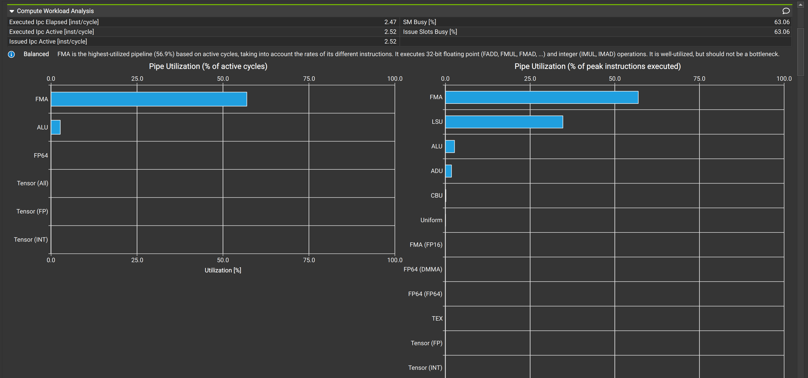
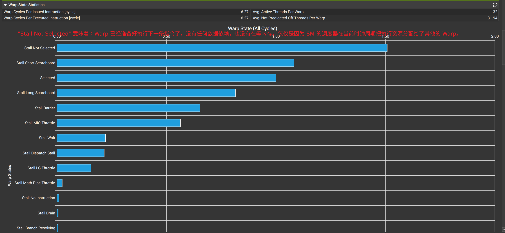

### 第一步：看流水线利用率 (Pipeline Utilization) —— 找出最累的“打工人”

GPU 的一个 SM 内部，实际上包含了好几种不同的“流水线”（你可以理解为不同专业的工人）。在这个模块的顶部，通常会有一个柱状图或表格，列出各个 Pipeline 的利用率。

谁的柱子最高（最接近总体的 SM 吞吐量），你的计算瓶颈就在哪里：

- **FMA / FP32 / FP64 (浮点乘加流水线)：**
    - **诊断：** 这是 GPU 最核心的算术单元。如果这里爆满，说明你的程序在做海量的数学运算（乘法、加法）。
    - **药方：** 考虑使用更快的数学近似函数（例如编译时加 `--use_fast_math`），或者审查算法，看看能否减少不必要的计算。
- **ALU (算术逻辑流水线 / 整数运算)：**
    - **诊断：** 如果这里很高，说明你的代码在做大量的整数加减、位运算、或者**循环索引计算、地址计算**。很多时候 ALU 过高是因为冗余的地址偏移计算引起的。
    - **药方：** 尝试把循环内不变的整数计算提到循环外（循环展开 `#pragma unroll` 也有奇效）。
- **Tensor Cores (张量核心，如适用)：**
    - **诊断：** 针对深度学习或特定矩阵运算。如果在使用 MMA (Matrix Multiply-Accumulate) 指令，这里会很高。
- **LSU (Load/Store Unit 流水线)：**
    - **诊断：** 虽然是算力瓶颈，但 LSU 很高意味着 SM 花了极其大量的指令周期在“发射”访存指令，这通常和之前说的“未合并访存”联动出现。

### 第二步：看 Warp 停滞原因 (Warp State / Stall Reasons) —— 找出“发呆”的原因

**这是 Compute Workload Analysis 中含金量最高的部分！** 即使是计算受限，Warp 也不是时时刻刻都在算，它们经常因为各种原因“停滞 (Stall)”。ncu 会给出一个非常直观的饼图或横向柱状图，列出 **Top Stall Reasons**。

你需要重点关注排名前两位的停滞原因：

- **Stall Wait (Execution Dependency / 执行依赖)：**
    
    - **现象：** 这是纯计算瓶颈中最常见的停滞。意思是下一条指令在等上一条指令的计算结果。比如 `a = b * c; d = a + e;`，算 `d` 的时候必须等 `a` 算完。
    - **药方：** 提高**指令级并行度 (ILP)**。多声明几个寄存器变量，让互不依赖的计算同时进行，填补等待的周期。
- **Stall Barrier (同步等待)：**
    
    - **现象：** 你的代码里用了 `__syncthreads()`。由于某个 Warp 跑得太慢，导致先跑完的 Warp 只能停在屏障前傻等。
    - **药方：** 检查导致各个 Warp 计算量不均衡的原因（负载不均衡）。
- **Stall Short Scoreboard：**
    
    - **现象：** Warp 正在等待 Shared Memory 的读写完成。
- **Stall Long Scoreboard：**
    - **现象：** Warp 正在等待 Global Memory (L1/L2/DRAM) 的读写完成。如果这个值最高，说明你其实还是**内存受限（延迟受限）**。

### 第三步：查杀“无声的性能杀手” —— 分支发散 (Branch Divergence)

在计算分析模块中，必须要看的一个指标是 **Warp Non-Predicated Execution Efficiency**（有些版本叫 Warp Execution Efficiency）。

- **这是什么：** CUDA 中一个 Warp 是 32 个线程“同上同下”的。如果在 `if-else` 语句中，16 个线程走了 `if`，16 个线程走了 `else`，那么硬件只能**先让 16 个走 `if`，另外 16 个发呆；然后再让另外 16 个走 `else`**。这会让计算效率瞬间减半！
- **怎么看：** 如果这个效率指标远低于 100%（比如只有 50% 甚至更低），说明存在严重的分支发散。
- **药方：** 尽量让条件分支的判断依赖于 Block ID 或 Warp ID，而不是 Thread ID；或者通过数学逻辑（如三元运算符、按位运算）来替代 `if-else` 分支。
---
**实战推演：** 如果你切换到 Compute Workload Analysis，发现最高的是 **ALU 流水线**，且 Stall Reason 大部分是 **Stall Wait**，你就应该立刻意识到：_“我的循环里可能有太复杂的整数索引计算，而且下一行代码死死依赖上一行的结果，没有并行起来。”_ 接着，你就可以去 Source 页面看汇编/源码的 Stall 提示了。
