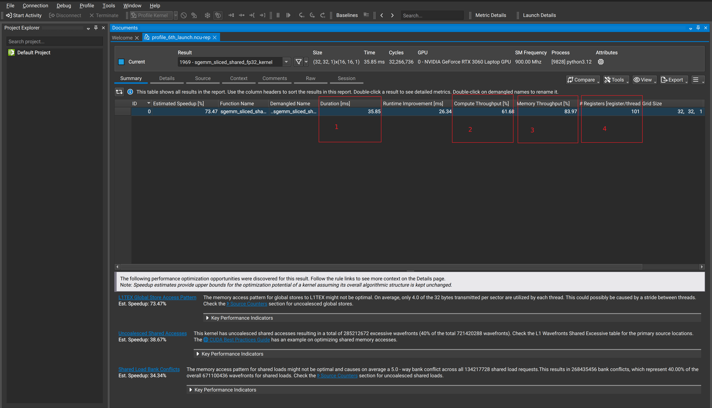

# 1. 可复现实验与热点筛选



> 截图只用于定位界面。指标名称会随 NCU 版本和 GPU 架构变化，图中的数值不是
> 本仓库所有 kernel 的基线。

## 工具分工

| 问题 | 首选工具 |
|---|---|
| 应用时间花在哪、CPU/GPU 是否有空洞 | Nsight Systems |
| 单个 CUDA kernel 为什么慢 | Nsight Compute |
| 数值是否正确 | PyTorch reference + pytest |
| register/spill/static SMEM | `ptxas -v` |
| 指令是否如预期生成 | NCU Source/SASS 或 `cuobjdump` |

NCU 的 Summary 是当前被选 launch 的摘要，不是完整应用的热点排行榜。多 kernel
程序应先用 Nsight Systems 或框架 profiler 确定热点。

## 采集前检查

1. Release 构建，并保留 `-lineinfo`。
2. 固定 backend、shape、dtype、编译参数和随机种子。
3. warmup 后同步，NVTX range 内只保留目标 launch。
4. 用非 profiler benchmark 保存基线 duration。
5. 同时保存 correctness 误差。

## Summary 的阅读顺序

### Duration 与 launch geometry

先确认 kernel 足够长、grid 足够大。少于一个完整 wave 的 grid 可能无法占满所有
SM；极短 kernel 的 profiler 计数和 launch overhead 也更难稳定。

### SOL 只做第一层分类

Compute 和 Memory SOL 表示相应资源相对于工具模型中峰值吞吐的利用程度。它们是
线索，不是“理论 FLOPS 达成率”的单一结论：

- 一侧接近上限：深入对应的 compute 或 memory section；
- 两侧都低：检查 grid、scheduler issue、依赖、同步和尾部效应；
- 两侧都高：kernel 可能同时有效使用多个资源，优化要看哪项先限制 duration。

不要使用固定的 80% 阈值判断所有 GPU 和所有 workload。

### 资源与 occupancy

记录 threads/block、registers/thread、static/dynamic SMEM，以及理论/实际
occupancy。寄存器数本身没有通用的“超过 100 就过高”规则；要看它是否改变驻留
block/warp 数，以及限制寄存器后是否引入 spill。

## Thread coarsening 的正确判断

让一个线程计算多个输出可能：

- 提高寄存器中的数据复用和 ILP；
- 减少地址计算、重复 load 和同步；
- 也可能增加寄存器、降低 occupancy、延长单线程依赖链。

因此应同时比较 duration、register、spill、eligible warps 和 memory transactions，
不能仅凭算术强度推断更快。

## 分阶段采集，避免一开始 `--set full`

先列出本机 section：

```bash
ncu --list-sections
```

日常 triage 可先采：

```bash
ncu \
  --section LaunchStats \
  --section SpeedOfLight \
  --section Occupancy \
  --section SchedulerStats \
  --section WarpStateStats \
  --launch-count 1 \
  ...
```

发现 memory 方向后再增加 Memory Workload；发现计算/调度问题后增加
Compute Workload、Instruction Stats 和 Source Counters。这样可以减少 replay pass
和测量扰动。

## Baseline 对比

NCU GUI/CLI baseline 的价值是比较同一个 kernel 优化前后，而不是拿不相关的两个
shape 做颜色对比。对比时必须保持：

- GPU 与 clocks/power 环境；
- 输入数据与 shape；
- math mode；
- launch 次数；
- 采集 section；
- 编译 target；
- correctness。

优先比较：

```text
duration
register/SMEM/spill
waves/occupancy
target pipeline
memory sectors/wavefront
eligible/issued warp
top source locations
```

## Shape sweep

单点 profiling 只解释一个点。选择能区分根因的 shape：

- 小/中/大问题；
- tile 边界前后；
- 方阵与瘦长；
- 小 K 与大 K；
- tail 比例高/低；
- grid 少于一 wave、约一 wave、多 wave。

先用 benchmark 找性能拐点，再对代表 shape 采 NCU，不要对全部组合运行 full set。

## 报告审查问题

打开报告后先问：

1. 捕获的是目标 backend 和目标 launch 吗？
2. duration 与 event baseline 同量级吗？
3. grid/block/SMEM/register 与源码预期一致吗？
4. report 是否发生大量 replay？
5. kernel 是否足够长且稳定？
6. 是否有 display/其他进程影响 L2/DRAM？
7. counter 的单位和聚合范围是什么？

## 最小实验记录

```text
commit/backend:
GPU/tool versions:
shape/dtype:
compile flags:
warmup/iterations:
duration:
max/mean error:
register/spill/SMEM:
SOL:
top limiter:
conclusion:
```

## 参考资料

- [Nsight Compute Compute Triage Guide](https://docs.nvidia.com/nsight-compute/ComputeTriage/)
- [Nsight Systems User Guide](https://docs.nvidia.com/nsight-systems/UserGuide/)
