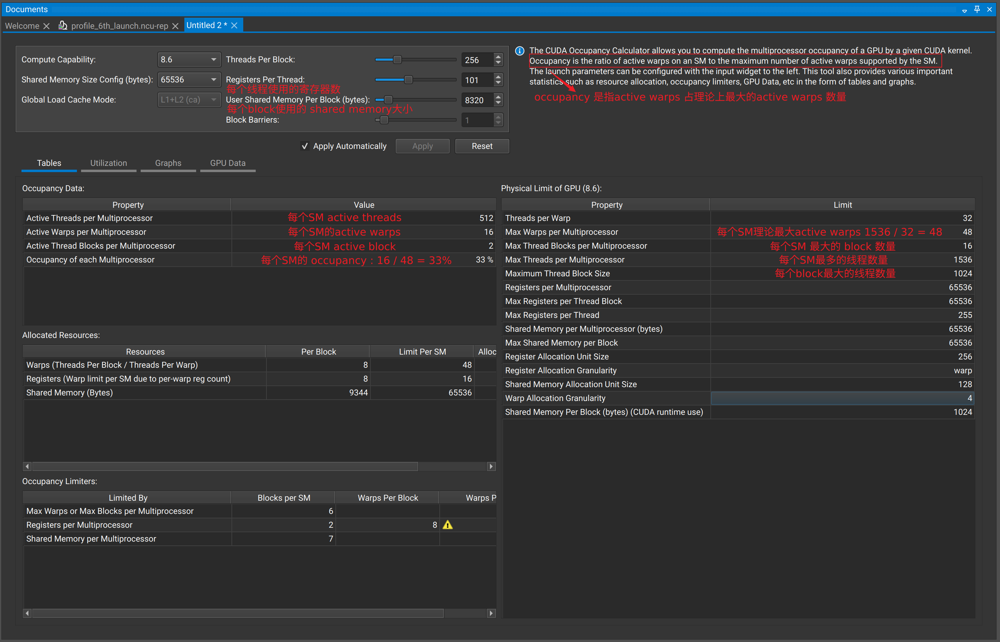

# Occupancy：驻留 warp，不是性能分数



Occupancy 的基本定义是：

```text
occupancy = active warps per SM / maximum warps per SM
```

active/resident 表示 warp 已分配到 SM，不代表它当前 eligible 或正在 issue。
Occupancy 的价值是提供更多可切换的 warp 来隐藏依赖和访存延迟；它不是越高越好，
也不存在对所有 kernel 通用的 50%–70% 最优区间。

## 理论 occupancy 的限制因素

一个 block 能否继续驻留取决于最先耗尽的资源：

- threads/warps per SM；
- blocks per SM；
- register file，且寄存器按硬件粒度分配；
- static + dynamic shared memory；
- 架构的 block/warp/thread 硬上限。

小 block 可能先撞到 blocks-per-SM 上限；大 block 或高寄存器 kernel 可能只能驻留
一个 block。使用 NCU Occupancy Calculator 或 CUDA occupancy API 计算，不要只做
连续除法。

## Theoretical 与 Achieved

- **Theoretical Occupancy**：由 launch 配置和静态资源模型计算的上限。
- **Achieved Occupancy**：运行期间 active warp 的硬件计数平均值。

差距可能来自 grid 太小、最后一个 wave 的 tail、block 执行时间不均或动态行为。
但即使 achieved occupancy 高，warp 也可能都在等待依赖。

## 判断是否值得提高

同时看：

1. eligible/issued warps 是否不足；
2. 主要 stall 是否有更多 warp 可以掩盖；
3. 目标管线或内存是否已经饱和；
4. 降寄存器是否产生 local-memory spill；
5. 缩小 tile 是否破坏数据复用。

`--maxrregcount` 是实验工具，不是免费优化。若 register 降低带来的 spill 大于新增
warp 的收益，性能会下降。

## Occupancy 实验设计

可以固定算法与 tile，仅改变 block size 或 register cap 做敏感性实验，但每组必须
记录：

```text
registers/thread
spill/local traffic
SMEM/block
resident blocks/warps
active/eligible/issued warps
target pipeline
duration
```

如果 occupancy 提高但 eligible warp 未改善，瓶颈可能不是可隐藏 latency；如果
eligible 改善但 DRAM/compute 已饱和，duration 也可能不变。

## Grid-limited 与 resource-limited

- resource-limited：每 SM 能驻留的 block 少；
- grid-limited：总 block 数本来就少，即使资源允许更多也没有 block 可调度。

瘦长 GEMM 常是 grid-limited。降低 registers/thread 并不会创造新的输出 block，
应考虑更小 tile 或 split-K。

## 理论值的边界

occupancy calculator 没有建模：

- warp 是否 eligible；
- block 负载差异；
- memory partition camping；
- cache 命中；
- 指令依赖；
- pipeline throughput；
- 最后 wave。

它用于筛选 launch 配置，不用于预测最终 duration。

## 参考资料

- [CUDA C++ Programming Guide: Occupancy](https://docs.nvidia.com/cuda/cuda-c-programming-guide/)
- [Nsight Compute Occupancy Calculator](https://docs.nvidia.com/nsight-compute/NsightCompute/)
